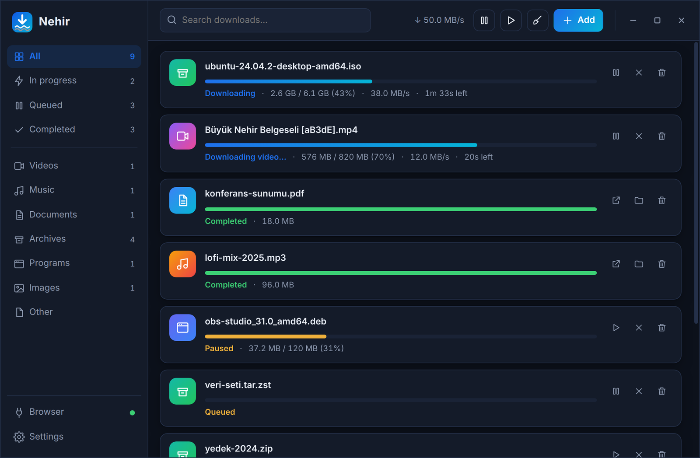
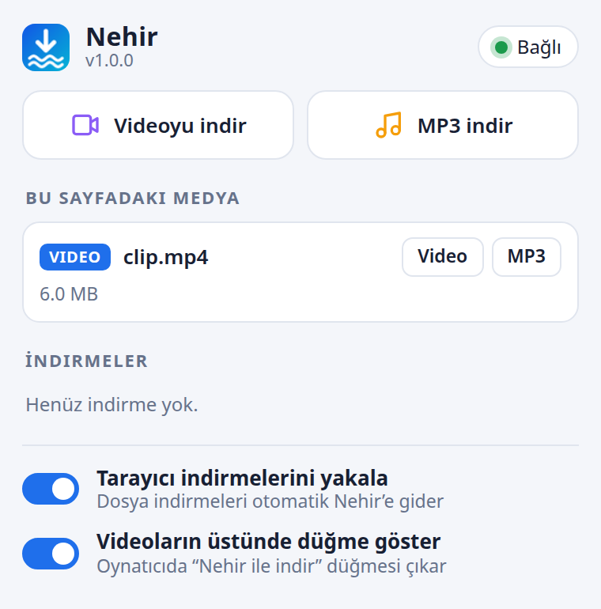
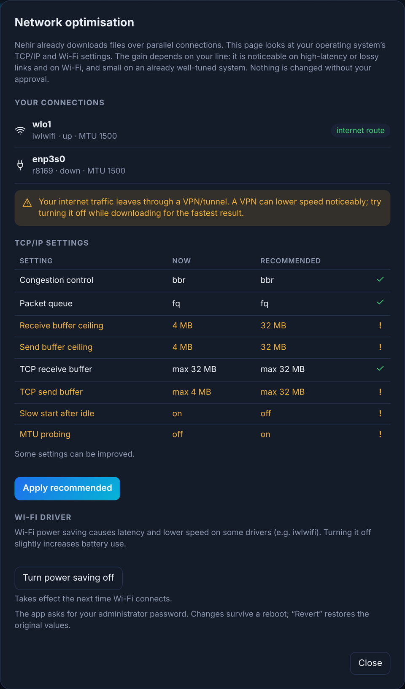

<div align="center">


# Nehir

### *Not drop by drop. Like a river.*

**A fast, multi-connection download manager for Linux: an IDM-style experience.**

It captures downloads and videos from your browser, fetches them over up to 32 parallel connections, and grabs video and music from 1000+ sites including YouTube.

[](https://github.com/MustafaKemal0146/nehir/releases/latest)
[](LICENSE)
[](#-installation)
[](https://www.rust-lang.org)
[](https://tauri.app)

[**Download**](https://github.com/MustafaKemal0146/nehir/releases/latest) · [Installation](#-installation) · [Usage](#-usage) · [Architecture](docs/ARCHITECTURE.md) · [Türkçe](README.md)

<br>



</div>

---

## ✨ Why Nehir?

Linux lacks a download manager that **steps into your browser and takes over downloads** like IDM does on Windows, and that is genuinely fast. The browser extension catches the download, the Nehir app fetches it over parallel connections, and all you do is press "download".

| | |
|---|---|
| ⚡ **Multi-connection downloads** | Splits a file into 1–32 parts and downloads them in parallel. An idle connection splits the biggest remaining part and takes half of it, so speed does not drop at the end. |
| ⏯️ **Pause and resume** | Survives closing the app or rebooting; it continues by itself where it stopped. |
| 🛡️ **File verification** | If the site lists a SHA-256 (or SHA-512, SHA-1, MD5), the extension finds it on the page or in a `SHA256SUMS` file, and the file is verified automatically when it finishes. You can also paste one. |
| 🔀 **Smart protocol** | Files download over many HTTP/1.1 connections; if the server limits connections, Nehir switches to HTTP/2 and continues over one connection. |
| 💾 **Disk pre-allocation** | The file's space is reserved up front (`fallocate`): less fragmentation, and a full disk is reported at the start, not hours later. |
| 🌐 **Network-loss tolerant** | When the connection drops, the download goes to "Waiting for network" and resumes by itself when the network is back or the computer wakes from sleep. |
| 🧩 **Browser extension** | One extension for Chrome, Brave, Edge, Chromium, Vivaldi, Opera and Firefox. Captures browser downloads and forwards cookies and `Referer` (sites that need a login work). |
| 🎬 **Download any video** | YouTube, Vimeo, X, Instagram, TikTok, Twitch, Dailymotion and 1000+ more through `yt-dlp`, including HLS (`.m3u8`) and DASH (`.mpd`) streams. |
| 🎚️ **Resolution picker** | Choose "Video" on the button over the player and see the real resolutions with **estimated sizes**: `2160p ~299 MB`, `1080p ~58 MB`… |
| 🎵 **Download as MP3** | One click from the same menu. Lands in the `Music` folder. |
| 🗂️ **Automatic organising** | Files go to `Videos`, `Music`, `Documents`, `Archives`, `Programs`, `Images`. Partial files live in a hidden folder, so your download folder stays clean. |
| 🚦 **Queue and speed limit** | Choose how many downloads run at once and the total speed. |
| 🔔 **Tray, clipboard, notifications** | Lives in the system tray and tells you when a downloadable link is on the clipboard. Notifications have **Open**, **Show in folder** and **Retry** buttons. |
| 🌙 **When downloads finish** | Put the computer to sleep, shut it down or quit Nehir. A 60-second countdown you can cancel appears first. |
| 🧭 **Setup wizard** | On first launch it walks you through the download folder, the browser extension (it opens the extensions page and tells you when it connects) and `yt-dlp`. |
| 🌍 **Turkish and English** | The language follows your computer's language automatically. |
| 🛜 **Network optimisation** | Inspects TCP/IP (BBR, buffers) and Wi-Fi driver settings; applies them with your approval and reverts in one click. [Details](#-network-optimisation) |
| 🔒 **Secure bridge** | Only browser extensions can talk to the local bridge. [Details](#-security) |

## 🖼️ Screenshots

<table>
  <tr>
    <td width="50%" align="center"><br><sub><b>Over the video:</b> pick a resolution with its size, one click to download. The × closes it until the page reloads.</sub></td>
    <td width="50%" align="center"><br><sub><b>Extension popup:</b> media on the page, live progress, one-click video/MP3.</sub></td>
  </tr>
</table>

## 📦 Installation

> **Tested on:** Zorin OS 18 (Ubuntu 24.04 based). Expected to work on Ubuntu 22.04+/Debian 12+ and derivatives.

### 1. Install the app

Download the `.deb` from [**Releases**](https://github.com/MustafaKemal0146/nehir/releases/latest):

```bash
sudo apt install ./nehir_1.1.0_amd64.deb
```

Open **Nehir** from your menu. (`apt` installs the required libraries automatically.)

### 2. Load the browser extension

The app puts the extension in `/usr/share/nehir/extension/`.

**Chrome / Brave / Edge / Chromium:**
1. Open `chrome://extensions` and turn on **Developer mode**.
2. Click **Load unpacked** and choose:
   ```
   /usr/share/nehir/extension/chrome
   ```

**Firefox:** `about:debugging` → *This Firefox* → *Load Temporary Add-on* → `/usr/share/nehir/extension/firefox/manifest.json`.
The Firefox package is ready but has been tested less than the Chromium-based ones.

> Store releases (Chrome Web Store / Firefox AMO) are planned. Until then use the method above. The folder is fixed, so updating the app updates the extension too (just press **reload** in the browser).

### 3. Install `yt-dlp` for videos

Open Nehir → **Settings → Video → Install yt-dlp**. It installs into your home (`~/.local/share/nehir/bin`) in one click, together with `deno`, which YouTube needs. Merging audio and video requires `ffmpeg` (`sudo apt install ffmpeg`).

## 🚀 Usage

- **Regular downloads:** click a file in your browser; the extension captures it and Nehir downloads it. If the app is closed, the extension starts it.
- **Video / music:** hover a player and press the blue button → **Video** (pick a resolution) or **Music (MP3)**.
- **Right-click:** on a link → *Download with Nehir*. On the page background → *Download this page's video / as MP3*.
- **Add manually:** **Add** in the app (or `Ctrl+N`) and paste an address. Dragging a link onto the window works too.
- **Extension popup:** the toolbar icon shows the media on the page and download progress.
- **File verification:** click a download to open its details: the result and the computed checksum are there; paste an expected checksum and press **Verify**.
- **When done:** the power button in the top bar offers *Sleep / Shut down / Quit Nehir*; it runs once.

## 🛜 Network optimisation

The **Network** button (bottom left) inspects your computer's network settings and shows what can be improved:

- **TCP/IP:** congestion control (BBR), packet queue (`fq`), TCP buffer ceilings, slow start after idle, MTU probing. Each setting shows its *current* and *recommended* value; anything already good is left alone.
- **Wi-Fi driver:** power saving causes latency and low speed on some drivers (e.g. `iwlwifi`); it can be turned off in one click.
- **VPN warning:** if your internet route goes through a VPN/tunnel (WireGuard, Cloudflare WARP…) it tells you; that is often what slows you down most.

<p align="center"></p>

**Honest expectations:** Nehir already downloads over parallel connections, which provides most of the speed. System tuning only makes a visible difference on high-latency/lossy links and on Wi-Fi; on a well-tuned system the gain is small (e.g. BBR already on). So the panel does not promise to "squeeze everything", it shows what can genuinely improve.

**Safety:** nothing changes without your approval. An administrator password is requested (`pkexec`, polkit). Everything written is fixed and documented ([`packaging/nehir-nettune`](packaging/nehir-nettune)): `/etc/sysctl.d/99-nehir-tcp.conf` and (for Wi-Fi) `/etc/NetworkManager/conf.d/99-nehir-wifi.conf`. Original values are backed up; **Revert** restores them all, and so does removing the package.

## 🧠 How it works

```
 Browser ── extension ──►  127.0.0.1:48213  ◄── Nehir (Rust)
 (captures downloads,       local bridge         multi-part engine · queue
  adds cookies + Referer)   (extensions only)    yt-dlp · ffmpeg · persistent state
```

- **Engine** (`nehir-core`): HTTP `Range` multi-part downloads, retry with back-off on network errors (429/503), switching to HTTP/2 when the server limits connections, single-stream fallback when ranges are unsupported, `fallocate` pre-allocation, resumable part state on disk, checksum verification at the end.
- **Bridge:** the extension posts downloads to the app through a tiny HTTP API on `127.0.0.1`.
- **Native host** (`nehir-host`): lets the browser start the app when it is closed. No URLs or cookies pass through it.
- **Network tuning** (`nettune`): inspects the system read-only; the writing is done only with the user's approval by a small privileged helper.
- **UI:** Tauri 2 with dependency-free JavaScript (≈50 KB).

More: [docs/ARCHITECTURE.md](docs/ARCHITECTURE.md)

## 🔒 Security

- The bridge listens on **`127.0.0.1` only**.
- Only `chrome-extension://` / `moz-extension://` origins (or requests carrying the extension's custom header) are accepted; **ordinary web pages cannot drive the app**. The `Host` header is verified too (against DNS rebinding).
- The extension **cannot choose the save folder**; only the app decides.
- Cookies are used only for the matching download and are not sent to a different host on a cross-host redirect.
- User data (settings, records) is written with `0600` permissions.

If you find a security issue please follow [SECURITY.md](SECURITY.md) instead of opening a public issue.

## 🛠️ Building from source

```bash
# System dependencies (Debian / Ubuntu / Zorin)
sudo apt install -y libwebkit2gtk-4.1-dev libgtk-3-dev libayatana-appindicator3-dev \
    librsvg2-dev libxdo-dev build-essential pkg-config curl
# Rust (https://rustup.rs) and Node.js 20+ are required too

git clone https://github.com/MustafaKemal0146/nehir && cd nehir

cargo test                              # engine, manager and bridge tests
(cd ui && npm install && npm run build) # UI
node extension/build.mjs                # extension → extension/dist/{chrome,firefox}
cargo run -p nehir-app                  # run the app

# build a .deb
cargo build --release -p nehir-app -p nehir-host
packaging/build-deb.sh                  # → dist/nehir_<version>_amd64.deb
```

To try the UI without building the app: `cd ui && npm run dev`. Outside Tauri it opens with sample data.

## 🗺️ Roadmap

- [ ] Flatpak (Flathub) and AppImage packages
- [ ] Chrome Web Store and Firefox AMO releases
- [x] Network optimisation (TCP/IP + Wi-Fi)
- [x] Sleep / shut down when downloads finish
- [x] File integrity verification (SHA-256, SHA-512, SHA-1, MD5)
- [x] First-run setup wizard
- [ ] Scheduler ("start at 02:00")
- [ ] Playlist and channel downloads
- [ ] Subtitles, cover art and MP3 tags
- [ ] Download history and search
- [ ] Bulk-download every link on a page

Got an idea or request? [Open an issue](https://github.com/MustafaKemal0146/nehir/issues).

## ⚠️ Responsibility

Nehir is a download tool. Respecting the copyright of what you download and the terms of the sites you use is **your responsibility**. DRM-protected content (Netflix, Disney+, etc.) is not supported and will not be.

## 🙏 Thanks

- [**yt-dlp**](https://github.com/yt-dlp/yt-dlp): the video extraction engine
- [**Tauri**](https://tauri.app): the desktop shell

## 📄 License

[MIT](LICENSE) © Mustafa Kemal Çıngıl
