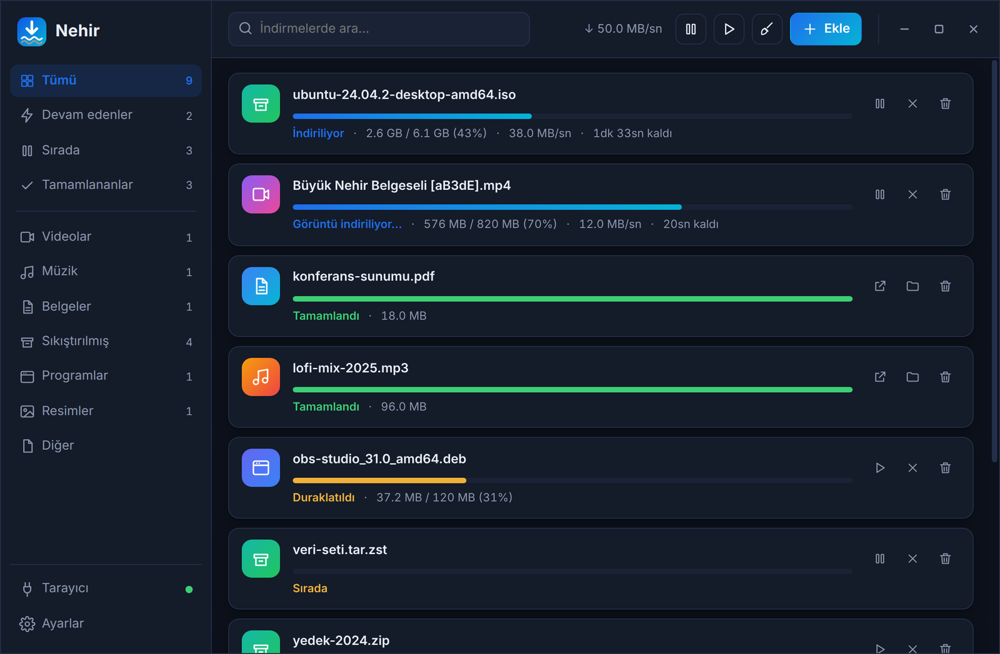
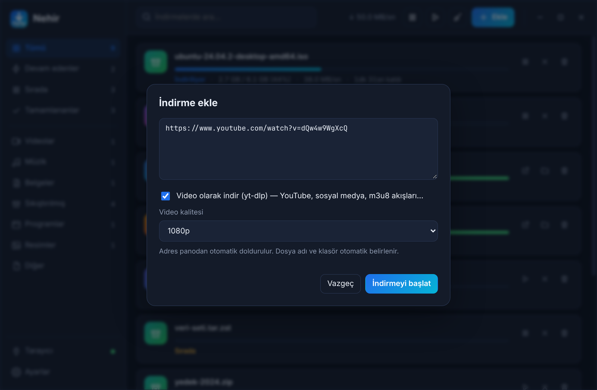
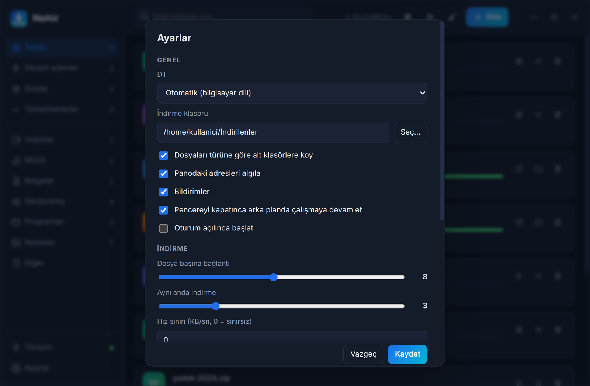
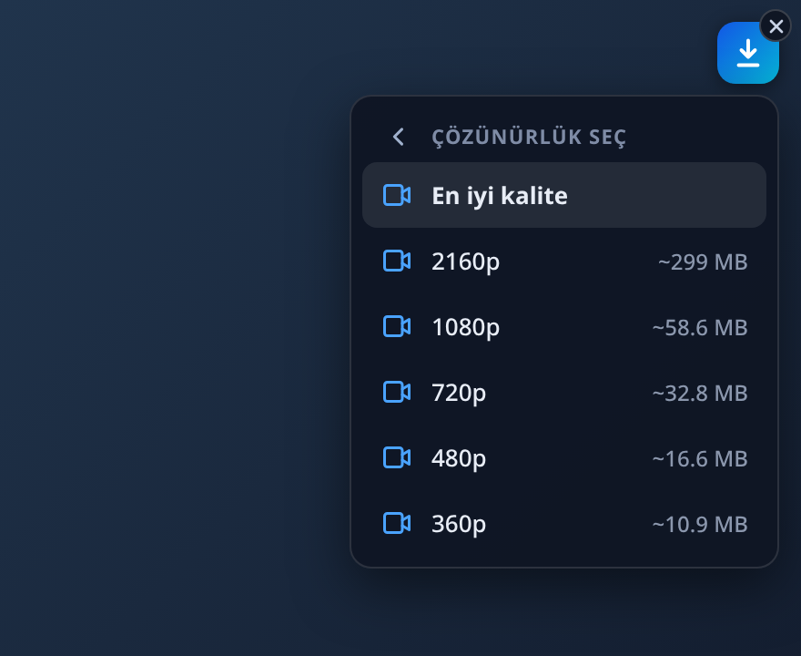
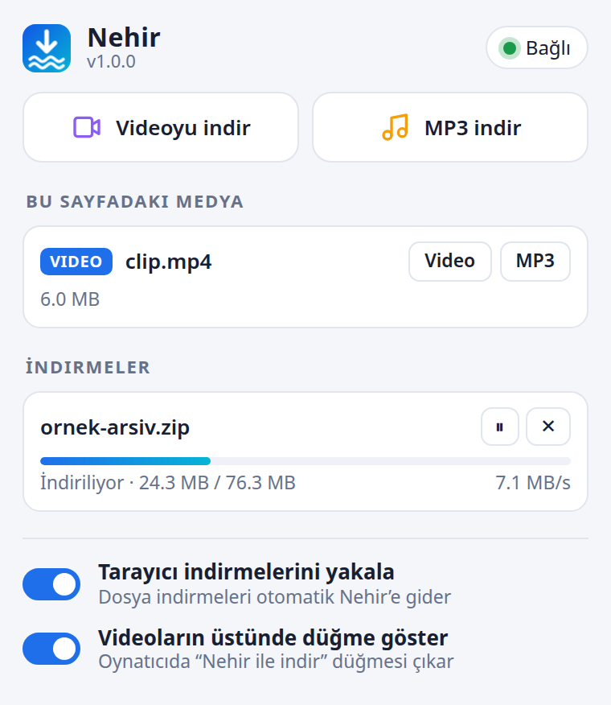
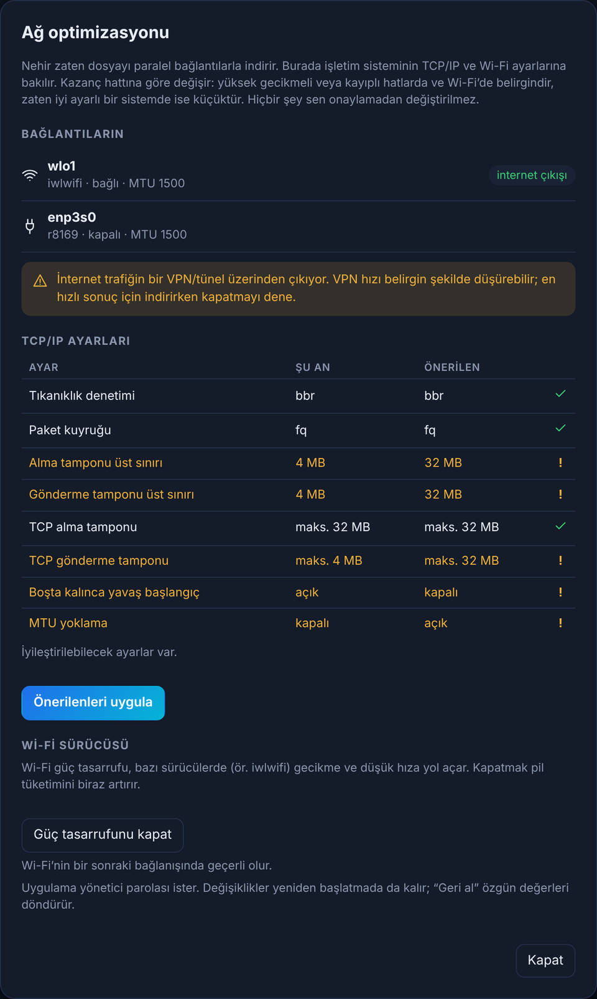

<div align="center">


# Nehir

### *Damla damla değil, nehir gibi.*

**Linux ve Windows için hızlı, çok bağlantılı indirme yöneticisi: IDM'in Linux karşılığı.**

Tarayıcıdaki indirmeleri ve videoları yakalar, 32'ye kadar paralel bağlantıyla indirir; YouTube dahil 1000'den fazla siteden video ve müzik çeker.

[](https://github.com/MustafaKemal0146/nehir/releases/latest)
[](LICENSE)
[](#-kurulum)
[](https://www.rust-lang.org)
[](https://tauri.app)

[**İndir**](https://github.com/MustafaKemal0146/nehir/releases/latest) · [Kurulum](#-kurulum) · [Nasıl kullanılır](#-nasıl-kullanılır) · [Mimari](docs/ARCHITECTURE.md) · [English](README.en.md)

<br>



</div>

---

## ✨ Neden Nehir?

Linux'ta Windows'taki IDM gibi, **tarayıcıya girip indirmeyi kendisi devralan** ve gerçekten hızlı indiren bir yöneticinin eksikliğini gidermek için yazıldı. Tarayıcı eklentisi indirmeyi yakalar, Nehir uygulaması paralel bağlantılarla indirir; sen sadece "indir"e basarsın.

| | |
|---|---|
| ⚡ **Çok bağlantılı indirme** | Dosyayı 1–32 parçaya bölüp paralel indirir. Boşta kalan bağlantı, en büyük kalan parçayı bölüp yarısını devralır, bu yüzden bitişe doğru yavaşlamaz. |
| ⏯️ **Duraklat ve devam et** | Uygulamayı kapatsan, bilgisayarı yeniden başlatsan bile kaldığı yerden, kendiliğinden sürer. |
| 🛡️ **Dosya doğrulama** | Sitede SHA-256 (ya da SHA-512, SHA-1, MD5) yazıyorsa eklenti onu sayfadan ya da `SHA256SUMS` dosyasından bulur; indirme bitince dosya otomatik doğrulanır. Elle de yapıştırılabilir. |
| 🔀 **Akıllı protokol** | Dosya çok bağlantılı HTTP/1.1 ile iner; sunucu bağlantı sayısını sınırlarsa Nehir HTTP/2'ye geçer ve parçalar tek bağlantıda sürer. |
| 💾 **Disk ön ayırma** | Dosyanın yeri baştan ayrılır (`fallocate`): parçalanma azalır, yer yetmezse indirme saatler sonra değil, en başta söylenir. |
| 🌐 **Ağ kopmasına dayanıklı** | Bağlantı gidince indirme "Ağ bekleniyor" durumuna geçer; ağ geri gelince ya da bilgisayar uykudan uyanınca kendiliğinden devam eder. |
| 🧩 **Tarayıcı eklentisi** | Chrome, Brave, Edge, Chromium, Vivaldi, Opera ve Firefox için tek eklenti. Tarayıcı indirmelerini yakalar, çerezleri ve `Referer`'i da taşır (giriş gerektiren siteler çalışır). |
| 🎬 **Her videoyu indir** | `yt-dlp` ile YouTube, Vimeo, X, Instagram, TikTok, Twitch, Dailymotion ve 1000'den fazla site. HLS (`.m3u8`) ve DASH (`.mpd`) akışları dahil. |
| 🎚️ **Çözünürlük seçici** | Videonun üstündeki düğmeden "Video" deyince gerçek çözünürlükler ve **tahmini boyutları** listelenir: `2160p ~299 MB`, `1080p ~58 MB`… |
| 🎵 **MP3 olarak indir** | Aynı menüden tek tıkla müzik. `Müzik/` klasörüne düşer. |
| 🗂️ **Otomatik düzen** | Dosyalar türüne göre `Videolar`, `Müzik`, `Belgeler`, `Sıkıştırılmış`, `Programlar`, `Resimler` klasörlerine yerleşir. Yarım dosyalar gizli klasörde tutulur, indirme klasörün kirlenmez. |
| 🚦 **Kuyruk ve hız sınırı** | Aynı anda kaç indirme çalışacağını ve toplam hızı sen belirlersin. |
| 🔔 **Tepsi, pano, bildirim** | Sistem tepsisinde yaşar. Panoya indirilebilir bir bağlantı kopyalayınca haber verir. Bildirimlerde **Aç**, **Klasörü göster** ve **Tekrar dene** düğmeleri vardır. |
| 🌙 **Bitince ne olsun?** | İndirmeler bitince bilgisayarı uyut, kapat ya da Nehir'den çık. Önce 60 saniyelik, iptal edilebilir bir geri sayım çıkar. |
| 🧭 **Kurulum sihirbazı** | İlk açılışta indirme klasörü, tarayıcı eklentisi (eklentiler sayfasını kendisi açar, bağlanınca haber verir) ve `yt-dlp` adım adım kurulur. |
| 🌍 **Türkçe ve İngilizce** | Dil bilgisayarının diline göre otomatik seçilir. |
| 🛜 **Ağ optimizasyonu** | TCP/IP (BBR, tamponlar) ve Wi-Fi sürücüsü ayarlarını inceler; onayınla uygular, tek tıkla geri alır. [Ayrıntı](#-ağ-optimizasyonu) |
| 🔒 **Güvenli köprü** | Eklenti ile uygulama arasındaki yerel köprüye yalnızca tarayıcı eklentileri erişebilir. [Ayrıntı](#-güvenlik) |

## 🖼️ Ekran görüntüleri

<table>
  <tr>
    <td width="50%"><br><sub><b>İndirme ekle:</b> adres panodan dolar, video için kalite seçilir.</sub></td>
    <td width="50%"><br><sub><b>Ayarlar:</b> bağlantı sayısı, hız sınırı, yakalanacak dosya türleri.</sub></td>
  </tr>
  <tr>
    <td width="50%" align="center"><br><sub><b>Videonun üstünde:</b> çözünürlük ve boyutla seç, tek tıkla indir. Çarpıyla kapatılır, sayfa yenilenince geri gelir.</sub></td>
    <td width="50%" align="center"><br><sub><b>Eklenti penceresi:</b> sayfadaki medya, canlı ilerleme, tek tık video/MP3.</sub></td>
  </tr>
</table>

## 📦 Kurulum

> 🪟 **Windows 10/11:** [Releases](https://github.com/MustafaKemal0146/nehir/releases/latest) sayfasından `Nehir_<sürüm>_x64-setup.exe`'yi indirip çalıştır; kurulum klasörünü seçebilirsin. Ayrıntı: [Windows](#-windows). Aşağıdaki adımlar Linux içindir.

> **Test edilen sistem:** Zorin OS 18 (Ubuntu 24.04 tabanlı). Ubuntu 22.04+/Debian 12+ ve türevlerinde çalışması beklenir.

### 1. Uygulamayı kur

[**Releases**](https://github.com/MustafaKemal0146/nehir/releases/latest) sayfasından `.deb` dosyasını indir:

```bash
sudo apt install ./nehir_1.2.0_amd64.deb
```

Menüden **Nehir**'i aç. (Gerekli kütüphaneler `apt` tarafından otomatik kurulur.)

### 2. Tarayıcı eklentisini yükle

Uygulama eklentiyi `/usr/share/nehir/extension/` altına koyar.

**Chrome / Brave / Edge / Chromium:**
1. Adres çubuğuna `chrome://extensions` yaz, sağ üstten **Geliştirici modu**'nu aç.
2. **Paketlenmemiş öğe yükle**'ye bas ve şu klasörü seç:
   ```
   /usr/share/nehir/extension/chrome
   ```

**Firefox:** `about:debugging` → *Bu Firefox* → *Geçici eklenti yükle* → `/usr/share/nehir/extension/firefox/manifest.json`.
Firefox paketi hazır ancak Chromium tabanlı tarayıcılar kadar çok denenmedi.

> Mağaza (Chrome Web Store / Firefox AMO) yayını planlanıyor; o zamana kadar yukarıdaki yöntem gerekir. Eklenti klasörü sabit olduğu için uygulama güncellenince eklenti de güncellenir (tarayıcıda **yenile** düğmesine basman yeterli).

### 3. Video indirmek için `yt-dlp` kur

Nehir'i aç → **Ayarlar → Video → yt-dlp'yi kur**. Tek tıkla, kullanıcı dizinine (`~/.local/share/nehir/bin`) kurulur; YouTube için gereken `deno` da birlikte gelir. Ses ve görüntüyü birleştirmek için `ffmpeg` gerekir (`sudo apt install ffmpeg`).

## 🚀 Nasıl kullanılır

- **Normal indirme:** Tarayıcıda bir dosyaya tıkla. Eklenti yakalar, Nehir indirir. Uygulama kapalıysa eklenti onu kendisi başlatır.
- **Video / müzik:** Oynatıcının üstüne gelince çıkan mavi düğmeye bas → **Video** (çözünürlük seç) ya da **Müzik (MP3)**.
- **Sağ tık:** Bir bağlantıya sağ tıkla → *Nehir ile indir*. Sayfada boş bir yere sağ tıkla → *Sayfadaki videoyu indir / MP3 olarak indir*.
- **Elle ekle:** Uygulamada **Ekle** (veya `Ctrl+N`), adresi yapıştır. Bir bağlantıyı pencereye sürükleyip bırakmak da çalışır.
- **Eklenti penceresi:** Araç çubuğundaki Nehir simgesi sayfadaki medyayı ve indirmelerin ilerlemesini gösterir.
- **Dosya doğrulama:** Bir indirmeye tıklayınca açılan ayrıntılarda sonuç ve hesaplanan özet görünür; beklenen özeti yapıştırıp **Doğrula** diyebilirsin.
- **Bitince:** Üst çubuktaki güç düğmesinden *Bilgisayarı uyut / kapat / Nehir'den çık* seçilir; bir kez uygulanır.

## 🛜 Ağ optimizasyonu

**Ağ** düğmesi (sol altta) bilgisayarının ağ ayarlarını inceler ve nelerin iyileştirilebileceğini gösterir:

- **TCP/IP:** tıkanıklık denetimi (BBR), paket kuyruğu (`fq`), TCP tampon üst sınırları, boşta kalan bağlantıda yavaş başlangıç, MTU yoklama. Her ayar için *şu anki* ve *önerilen* değer görünür; zaten uygunsa dokunulmaz.
- **Wi-Fi sürücüsü:** güç tasarrufu bazı sürücülerde (ör. `iwlwifi`) gecikme ve düşük hız yapar; tek tıkla kapatılabilir.
- **VPN uyarısı:** internet çıkışın bir VPN/tünelden geçiyorsa (WireGuard, Cloudflare WARP…) bunu söyler; çoğu zaman hızı en çok bu düşürür.

<p align="center"></p>

**Dürüst beklenti:** Nehir zaten dosyayı paralel bağlantılarla indirir ve bu, hızın büyük kısmını sağlar. Sistem ayarları yalnızca yüksek gecikmeli/kayıplı hatlarda ve Wi-Fi'de gözle görülür fark yapar; iyi ayarlı bir sistemde kazanç küçüktür (ör. BBR zaten açıksa). Bu yüzden panel "her şeyi sömür" demez, neyin gerçekten iyileşebileceğini gösterir.

**Güvenlik:** Hiçbir şey sen onaylamadan değişmez. Değişiklik için yönetici parolası istenir (`pkexec`, polkit). Yazılan her şey sabit ve belgelidir ([`packaging/nehir-nettune`](packaging/nehir-nettune)): `/etc/sysctl.d/99-nehir-tcp.conf` ve (Wi-Fi için) `/etc/NetworkManager/conf.d/99-nehir-wifi.conf`. Özgün değerler yedeklenir; **Geri al** hepsini döndürür, paketi kaldırmak da öyle.

## 🧠 Nasıl çalışır?

```
 Tarayıcı ── eklenti ──►  127.0.0.1:48213  ◄── Nehir (Rust)
 (indirmeyi yakalar,        yerel köprü          çok parçalı motor · kuyruk
  çerez + Referer ekler)    (yalnızca eklenti)   yt-dlp · ffmpeg · kalıcı kayıt
```

- **Motor** (`nehir-core`): HTTP `Range` ile parçalı indirme, ağ hatalarına karşı yeniden deneme ve geri çekilme (429/503), sunucu bağlantıları sınırlarsa HTTP/2'ye geçiş, Range desteği yoksa tek akışa düşme, `fallocate` ile yer ayırma, parça durumunu diske yazarak devam etme, bitince özet doğrulama.
- **Köprü:** Eklenti, `127.0.0.1` üzerinde küçük bir HTTP API'siyle uygulamaya indirme gönderir.
- **Native host** (`nehir-host`): Uygulama kapalıyken tarayıcının onu başlatabilmesi için. Üzerinden URL ya da çerez geçmez.
- **Ağ ayarları** (`nettune`): sistemi salt okunur inceler; yazma işini yalnızca kullanıcı onayıyla, küçük bir yetkili yardımcı yapar.
- **Arayüz:** Tauri 2 + bağımlılıksız JavaScript (≈50 KB).

Ayrıntılar: [docs/ARCHITECTURE.md](docs/ARCHITECTURE.md)

## 🔒 Güvenlik

- Köprü **yalnızca `127.0.0.1`**'de dinler.
- Yalnızca `chrome-extension://` / `moz-extension://` kökenli istekler (ya da eklentinin özel başlığını taşıyanlar) kabul edilir; **sıradan web siteleri uygulamayı yönlendiremez**. `Host` başlığı da doğrulanır (DNS rebinding'e karşı).
- Eklenti, indirmenin **kaydedileceği klasörü seçemez**; hedefi yalnızca uygulama belirler.
- Çerezler yalnızca ilgili indirme için kullanılır ve aynı sunucudan başka bir sunucuya yönlendirmede gönderilmez.
- Kullanıcı verisi (ayarlar, kayıtlar) Linux'ta `0600` izinleriyle yazılır; Windows'ta kullanıcı profili zaten yalnızca sahibine açıktır.

Bir güvenlik sorunu bulursan lütfen herkese açık issue yerine [SECURITY.md](SECURITY.md)'deki yolu izle.

## 🪟 Windows

Windows 10/11 için aynı kod tabanından derlenir. Tarayıcıdaki indirmeleri yakalama, çok bağlantılı indirme, video/MP3 (yt-dlp), kuyruk, hız sınırı, tepsi, otomatik başlatma ve "bitince uyut/kapat" çalışır. Linux'tan farkları:

| | Windows'ta |
|---|---|
| **Kurulum** | [Releases](https://github.com/MustafaKemal0146/nehir/releases/latest) sayfasından `Nehir_<sürüm>_x64-setup.exe`'yi indirip çalıştır (≈5 MB). Kullanıcı başına kurulur (`%LOCALAPPDATA%\Nehir`, yönetici yetkisi gerekmez), Başlat menüsüne eklenir, WebView2 yoksa yükler. Kaldırınca tarayıcı kayıtları ve "Windows ile başlat" girdisi de silinir. Sessiz kurulum: `Nehir_…-setup.exe /S`. |
| **Native messaging** | Manifestler `%LOCALAPPDATA%\nehir\native-messaging\` altına yazılır; Chrome, Edge, Brave, Chromium ve Firefox için `HKCU\Software\…\NativeMessagingHosts\org.nehir.host` kayıt defteri anahtarları bunlara yöneltilir. Vivaldi ve Opera, Chrome'un anahtarını okur. |
| **`yt-dlp`, `deno`, `ffmpeg`** | **Ayarlar → Video → yt-dlp'yi kur** üçünü de `%LOCALAPPDATA%\nehir\bin\` altına kurar (`ffmpeg` olmadan ses ve görüntü birleştirilemez, yalnızca düşük çözünürlük iner). |
| **Verilerin yeri** | Ayarlar `%APPDATA%\nehir\`, indirme kayıtları ve ikililer `%LOCALAPPDATA%\nehir\`. |
| **İnternetten geldi işareti** | Tamamlanan dosyalara tarayıcılardaki gibi `Zone.Identifier` (Mark-of-the-Web) yazılır; böylece `.exe`/`.msi` dosyalarında SmartScreen ve Defender uyarısı korunur. |
| **Dosya adları** | Windows'un yasak karakterleri (`< > : " \| ? *`), ayrılmış adlar (`CON`, `NUL`, `COM1`…) ve sondaki nokta/boşluk temizlenir. `Güzel: Video` → `Güzel - Video`. |
| **Ağ optimizasyonu** | Yok (BBR, `/proc/sys` ve polkit Linux'a özgü); Windows'ta düğme gizlenir. |
| **Bildirimler** | Düğmesiz (Aç/Klasörü göster/Tekrar dene düğmeleri yalnızca Linux'ta). |
| **Chrome eklentisi** | `…\Nehir\extension\chrome` klasörü; `chrome://extensions` → Geliştirici modu → *Paketlenmemiş öğe yükle*. |

Windows'ta kaynaktan derleme (PowerShell; Rust MSVC, Node.js 20+ ve Visual Studio Build Tools "C++ ile masaüstü geliştirme" gerekir):

```powershell
git clone https://github.com/MustafaKemal0146/nehir; cd nehir
cargo test -p nehir-core -p nehir-host -p nehir-daemon
# Gerçek ağ ve araçlarla uçtan uca deneme (yt-dlp/deno/ffmpeg kurar, ~200 MB indirir):
cargo test -p nehir-core --test windows_tools -- --ignored --nocapture
(cd ui; npm ci; npm run build)
node extension/build.mjs
cargo run -p nehir-app

# Kurulum paketi (NSIS): önce `cargo install tauri-cli --version "^2" --locked`
packaging/windows/build.ps1             # → target\release\bundle\nsis\Nehir_<sürüm>_x64-setup.exe
```

## 🛠️ Kaynaktan derleme

```bash
# Sistem bağımlılıkları (Debian / Ubuntu / Zorin)
sudo apt install -y libwebkit2gtk-4.1-dev libgtk-3-dev libayatana-appindicator3-dev \
    librsvg2-dev libxdo-dev build-essential pkg-config curl
# Rust (https://rustup.rs) ve Node.js 20+ de gerekli

git clone https://github.com/MustafaKemal0146/nehir && cd nehir

cargo test                              # motor, yönetici ve köprü testleri
(cd ui && npm install && npm run build) # arayüz
node extension/build.mjs                # eklenti → extension/dist/{chrome,firefox}
cargo run -p nehir-app                  # uygulamayı çalıştır

# .deb paketi üret
cargo build --release -p nehir-app -p nehir-host
packaging/build-deb.sh                  # → dist/nehir_<sürüm>_amd64.deb
```

Arayüzü uygulamayı derlemeden denemek için `cd ui && npm run dev`: Tauri dışında örnek verilerle açılır.

## 🗺️ Yol haritası

- [ ] Flatpak (Flathub) ve AppImage paketleri
- [ ] Chrome Web Store ve Firefox AMO yayını
- [x] Ağ optimizasyonu (TCP/IP + Wi-Fi)
- [x] İndirmeler bitince uyut / kapat
- [x] Dosya bütünlüğü doğrulama (SHA-256, SHA-512, SHA-1, MD5)
- [x] İlk açılış sihirbazı
- [ ] Zamanlayıcı ("gece 02:00'de başla")
- [ ] Oynatma listesi ve kanal indirme
- [ ] Altyazı, kapak resmi ve MP3 etiketleri
- [ ] İndirme geçmişi ve arama
- [ ] Sayfadaki tüm bağlantıları toplu indirme

Fikrin ya da isteğin mi var? [Issue aç](https://github.com/MustafaKemal0146/nehir/issues).

## ⚠️ Sorumluluk

Nehir bir indirme aracıdır. İndirdiğin içeriğin telif haklarına ve sitelerin kullanım koşullarına uymak **sana aittir**. DRM korumalı içerikler (Netflix, Disney+ vb.) desteklenmez ve desteklenmeyecektir.

## 🙏 Teşekkürler

- [**yt-dlp**](https://github.com/yt-dlp/yt-dlp): video çıkarma motoru
- [**Tauri**](https://tauri.app): masaüstü kabuğu

## 📄 Lisans

[MIT](LICENSE) © Mustafa Kemal Çıngıl
